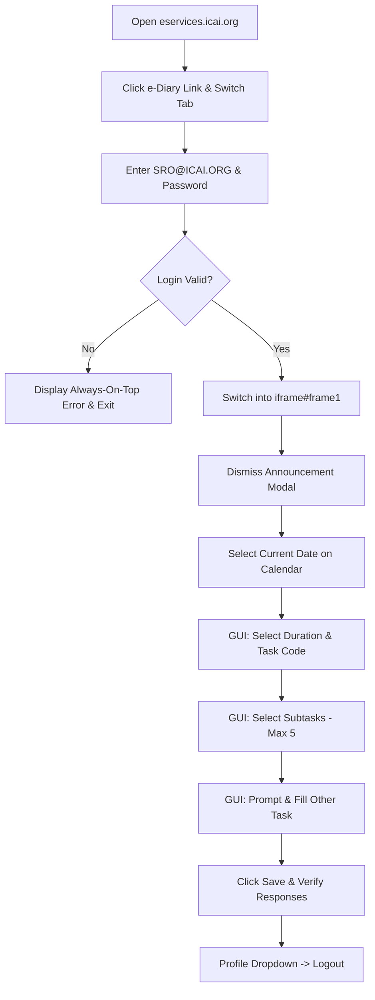

# ⚡ ICAI Articleship e-Diary Automation

A robust, fully automated Python solution for chartered accountancy (CA) students to record their daily articleship e-Diary entries on the official **ICAI e-Services Portal** (`eservices.icai.org`).

Built with **Selenium (v4+)** and **Tkinter**, it handles dynamic iframe navigation, modal dismissal, credential verification, and user selections through an **Always-On-Top** graphical interface.

---

## 🌟 Key Features

- **Driverless Setup**: Utilizes Selenium Manager (Selenium 4.6+)—no manual ChromeDriver downloads or third-party managers required.
- **Smart Login & Suffix Handling**: Automatically normalizes and appends `@ICAI.ORG` to the entered SRO number.
- **Credential Validation**: Detects incorrect login credentials (`#loginPwdMsg`) and displays an instant desktop alert.
- **`iframe#frame1` Awareness**: Specifically engineered to switch contexts into internal application iframes where the ICAI e-Diary modal and dashboard controls reside.
- **Robust Modal Dismissal**: Safely dismisses announcement dialogs (`#showResponseModal`) and clears backdrop blockers before proceeding.
- **Always-On-Top GUI Flow**:
  - **Step 1: Duration & Task**: Quick selection for Full Day (`1`) or Half Day (`0.5`) across all official task codes (`T1` to `T18`).
  - **Step 2: Subtask Selection**: Dynamically extracts available subtasks with an automated safeguard enforcing the **maximum 5 subtask selection** rule.
  - **Step 3: Other Task**: Optional prompt allowing custom description entry for `#other_task`.
- **Validation Notice Handling**: Catches `#responseDataBody` warnings (e.g., effort already filled for date) gracefully.
- **Full Session Lifecycle**: Automatically saves entry, triggers profile dropdown (`#dLabel`), and executes a secure logout.

---

## 🛠️ Requirements

- **Python 3.10+**
- **Google Chrome** installed
- Required libraries:
  ```bash
  pip install selenium
  ```
  *(Tkinter comes bundled with standard Python installations on Windows).*

---

## 🚀 Quick Start

### 1. Clone the Repository
```bash
git clone https://github.com/your-username/icai-ediary-automation.git
cd icai-ediary-automation
```

### 2. Configure Credentials
Open `icai_ediary_automation.py` and specify your credentials at the top:
```python
USER_SRO      = "SRO0816642"       # Your ICAI SRO Number (e.g., SRO1234567)
USER_PASSWORD = "YourPasswordHere" # Your Portal Password
```
*(Note: If left as default placeholders, an Always-On-Top prompt will ask for credentials at runtime).*

### 3. Run the Automation
```powershell
python icai_ediary_automation.py
```

---

## 📋 Automation Workflow



---

## 🔒 Security & Privacy

- Your credentials stay strictly local to your machine.
- Chrome's native "Save Password" and credential sync bubbles are explicitly suppressed via ChromeOptions to avoid UI locking and credential leakage.
- Never commit files containing your raw passwords to public GitHub repositories. Use `.gitignore` or environment variables if desired.

---

## ⚖️ Disclaimer

This automation script is an independent community utility created for educational and personal workflow efficiency. It is neither affiliated with nor endorsed by The Institute of Chartered Accountants of India (ICAI). Use responsibly in compliance with ICAI portal guidelines.
